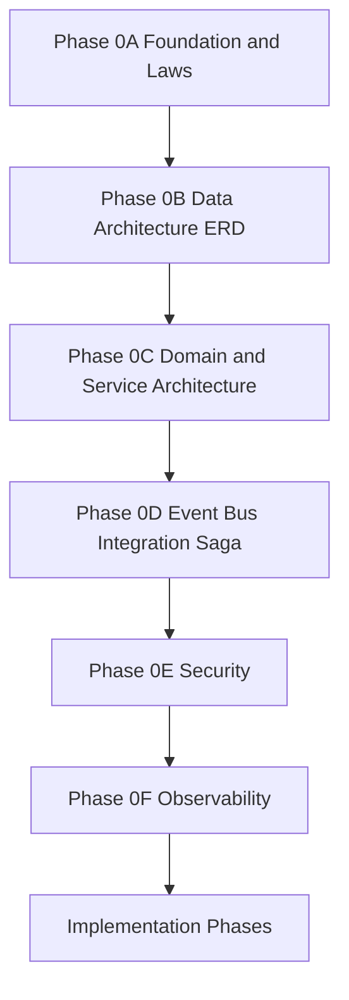
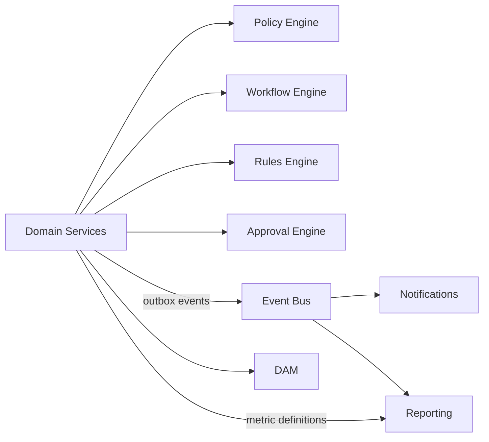

# Architecture Dependency Graph

## Kernel interaction (logical)

## Related

- [Master Index](../README.md)
- [Phase 0C Service Boundaries](../01-domain/phase-0c-enterprise-domain-service-architecture.md)
- [Phase 0D Integration](../02-integration/phase-0d-event-bus-integration-saga.md)
