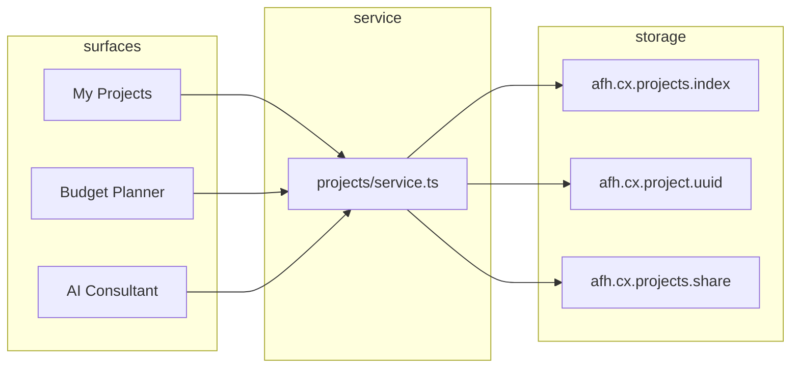

# Project History Architecture (RC9.4)

## Overview

Customer furnishing projects are stored as versioned documents shared by the AI Consultant and Intelligent Budget Planner. The dashboard reads a lightweight index; full project payloads load on demand.

## Data flow

## Index vs full record

**`ProjectListItem`** (index row):

- id, title, status, timestamps, owner label, customer name
- template id, budget/total PKR, room count
- aiAssisted flag, quotation status, latest version number

**`FurnishingProject`** (full record):

- All rooms with independent briefs, lines, tiers, notes
- Consultant memory + message history (last 40 messages)
- Quotes (multiple, `isLatest` flag)
- Notes, collaborators, share links
- Version snapshots (up to 50)

## Resume paths

| Entry | Behaviour |
|---|---|
| `/planner?projectId=` | Load project → restore active room via `restorePlannerFromRoom` |
| `/planner?projectId=&roomId=` | Restore specific room |
| `/consultant?projectId=` | Hydrate memory + messages; inject welcome-back if empty |
| `/my-projects?share={token}` | Resolve token → show shared project banner |

## Guest → account merge

On login, `mergeProjectsOnLogin(accountId, label)` reassigns projects owned by `guest-local` to the authenticated owner id. Mirrors wishlist merge pattern from RC9.1.

## CRM projection

`buildCrmProjectMeta(project)` produces a stable JSON blob for `enqueueLead` meta:

- `projectId`, `projectStatus`, `latestVersionId`, `latestVersionNumber`
- `plannerSummary`, `aiSummary`, `budgetPkr`, `totalPkr`
- `quotationId`, `quotationTotal`
- `rooms[]` summary, `customerNotes[]`, `aiAssisted`

## Performance

- Dashboard: O(n) over index only (max 200 rows)
- Open project: single `localStorage` read
- Consultant sync: debounced 400ms, no version snapshot unless planner saves explicitly
