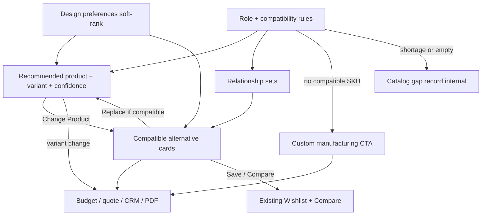

# RC10.3 — Implementation Plan (Frozen)

**Status:** Planning approved — **FROZEN** until RC10.1 is committed and RC10.2 is implemented and committed  
**Date:** 2026-07-21  
**Phase title:** Smart Product Configuration & Quote Optimization  
**Last planning update:** Architectural notes (compatibility, collections, relationships, quote extensibility, confidence, catalog gaps, visualization hooks)

**Do not implement RC10.3 yet.** No code, no new features, no roadmap reordering. This document is the sole planning artifact for the phase.

---

## Sequence (locked)

```
RC10.1  Interior Design Studio          → commit first
   ↓
RC10.2  Notifications & Communication → complete + commit
   ↓
RC10.3  Smart Product Configuration   → revisit this frozen plan, then implement
   ↓
RC10.4  Collaboration & Team Workspace (+ Orders/CRM deferred here or adjacent)
   ↓
RC10.5  Cloud Sync & Multi-Device
```

**Do not skip RC10.2.** Notifications will later integrate with quotations, product changes, CRM, and sales conversations.

Former “Orders, CRM & Sales Workflow” remains deferred to **RC10.4+** (already reflected in `docs/rc10/README.md`).

---

## Objective

Transform the Budget Planner from a fixed product recommender into an AI-assisted **furnishing configurator**:

- AI recommends **roles** (requirements), not raw SKUs as the primary concept  
- Each role has a **recommended product**, optional **variant**, and **compatible** alternatives  
- Customer can change product/variant without changing the required role  
- Budgets, quotations, explanations, and CRM lead data update instantly  
- Never invent catalog products; offer **custom manufacturing** when no match exists  

---

## Core design model

```
Role (+ compatible category rules)
  ↓
Recommended Product  (+ relationship: Recommended)
  ↓
Selected Variant (color / material / finish / upholstery / size / configuration)
  ↓
Related products by type:
  Alternatives | Upgrade | Budget Option | Matching Collection | Accessories
```

**Example**

| Layer | Value |
|-------|--------|
| Role | Executive Office Chair |
| Compatibility | Office / Executive / Ergonomic Chairs only |
| Product | Executive Mesh Chair |
| Collection | Premium Executive (first-class entity) |
| Variant | Black · Mesh · High Back |
| Alternatives | Leather / Wooden / Premium chairs **within compatibility** |

Variants live **under** a product (`CatalogueProduct.variants[]`). They are **not** duplicate catalog products.

---

## Existing foundation (reuse — do not rewrite)

| Asset | Location | RC10.3 use |
|-------|----------|------------|
| Role templates + slugs | `intelligent/templates.ts` | Role identity; extend with **compatible categories** |
| Grounding / ranking | `intelligent/grounding.ts` | Ranking within the compatibility set |
| Optimize + alternatives | `intelligent/optimize.ts` | Seed related-product lists; expand relationship types |
| Conceptual fallback | `ConceptualLine` | Custom manufacturing path + catalog-gap recording |
| Product variants | `catalogue.ts` `ProductVariant` | Variant picker |
| Collection field today | `CatalogueProduct.collection` (string) | Elevate to **first-class collection entity** (additive model) |
| Dimensions / lead / stock | `dimensions?`, `availability?`, `leadTime?`, `rating?` | Cards, ranking, explanations |
| Product links today | `complementaryIds`, `pairedIds` | Seed for relationship types |
| Wishlist / Compare | `cx/stores.ts` | Favorites from alternatives drawer |
| Quotes / CRM / PDF | `recordQuote`, `enqueueLead`, print HTML | Reflect configured lines; leave room for bundle pricing fields |

**Verdict:** RC10.3 is primarily **orchestration + UX + additive catalog/role metadata**, not a new AI engine.

---

## Constraints (unchanged)

- No AI Consultant architecture rewrite  
- No authentication / authorization / routing changes  
- No project persistence model / `afh.cx.*` key namespace changes  
- No collaboration rewrite  
- No cloud sync / new CX APIs before **RC10.5**  
- No inventing products outside the catalog  
- Prefer **additive** contracts; do not break `planFromBrief` / `OptimizationResult`  
- Soft-rank by preferences by default (hard-filter only if user explicitly requests)  
- No visualization implementation in RC10.3 (hooks only)  
- No discount / bundle pricing implementation in RC10.3 (schema headroom only)  
- No customer-facing catalog-gap UI; no confidence UI in this phase  

---

## Architectural design decisions (planning review)

Compatible with the existing design; **design now, implement only when RC10.3 coding starts**.

### A1. Product compatibility rules (not taxonomy alone)

Do **not** rely only on taxonomy slugs for replacements.

Each planner role must declare **compatible product categories** (and/or allow-lists) so unsuitable swaps are impossible.

| Role example | Compatible replacements |
|--------------|-------------------------|
| Office Chair | Office / Executive / Ergonomic Chairs |
| School Desk | School Desks only |
| Hospital Bed | Medical Beds only |

**Rule:** The alternatives drawer must only display products that pass the role’s compatibility set. Taxonomy ranking applies **inside** that set.

Implementation sketch (when coding): extend `TemplateRole` with additive fields such as `compatibleCategories` / `compatibleTaxonomySlugs` (exact names at impl time); filter drawer + swap validation against that set.

### A2. Collections as first-class objects

Treat collections as **catalog entities**, not mere free-text tags.

Examples: Premium Executive, Luxury Heritage, Modern Living, Economy Office.

| Concern | Design |
|---------|--------|
| Identity | Stable collection id + display name |
| Products | Reference collection id (migrate from string `collection` additively) |
| Recommendations | Prefer / explain “from the Premium Executive collection” |
| Relationships | “Matching Collection” type uses collection identity |

RC10.3 may introduce a small `CatalogueCollection` (or equivalent) map and keep string `collection` as display fallback for compatibility — **no breaking rename of persisted project lines**.

### A3. Future visualization hooks (do not implement)

Do **not** build Room Layout, 3D, or AR in RC10.3.

Ensure planner architecture can later attach:

- Room Layout  
- 3D Preview  
- AR Preview  

without redesigning the configurator.

**Hook approach:** keep configured lines as stable `{ role, productId, variantId?, qty, zone? }` snapshots; avoid UI that assumes lines are ephemeral calculator-only output. Optional opaque `visualizationRef` / extension point on room or project (additive, unused) is enough — no renderer.

### A4. Product relationship types

Expand beyond a single “Alternatives” list. Design support for:

| Type | Intent |
|------|--------|
| **Recommended** | Primary pick for the role |
| **Alternatives** | Compatible same-role substitutes |
| **Upgrade** | Higher tier / premium within compatibility |
| **Budget Option** | Lower-cost compatible option |
| **Matching Collection** | Same collection companions |
| **Accessories** | Complementary / paired items |

Reuse/seed from existing `alternatives`, `complementaryIds`, `pairedIds`, and upgrade/downgrade hints. UI in RC10.3 may still lead with Alternatives cards; other types are first-class in the data model so richer package UX can land without reshaping.

### A5. Bundle pricing preparation (do not implement discounts)

Do **not** implement package discounts, promos, free delivery, or bundle pricing in RC10.3.

Ensure the **quotation model** can later add, without schema redesign:

- Package discounts  
- Promotional offers  
- Free delivery  
- Bundle pricing  

**Approach:** quotation / quote line payloads should allow additive optional adjustment slots (e.g. `adjustments[]` or reserved optional fields on quote totals) with zero entries today. Existing `recordQuote` line shape stays valid when adjustments are absent.

### A6. Recommendation confidence (internal only)

Internally support confidence metadata per recommendation:

- **High** · **Medium** · **Low**

Used later for explanation tone and ranking diagnostics. **No customer UI in RC10.3.**

Attach as internal planning metadata on optimized/configured lines (not required in persisted room lines unless additive and ignored by current readers).

### A7. Catalog completeness tracking (internal / ops)

When the catalog lacks suitable products for a role, **record a catalog gap** instead of silently proceeding.

Example:

| Field | Value |
|-------|--------|
| Role | Executive Visitor Chairs |
| Required / recommended qty | 8 |
| Available compatible SKUs | 2 |
| Gap | 6 (or qualitative shortage) |

Also record when the compatible set is empty (custom manufacturing path).

**Audience:** future catalog management — **not** customer-facing UI in RC10.3. Persist locally in an additive side channel or in-memory session log during plan generation; exact store decided at impl without breaking `afh.cx.*` project keys.

---

## Refined capabilities (customer-facing RC10.3)

### 1. Product variants (required)

Under the recommended product, expose variant groups already in catalog:

- Color, material, finish, upholstery (via material/finish groups), size/dimensions, configuration (e.g. high/low back)

Selecting a variant updates price (`priceDeltaPkr` / `resolveVariantPrice`), totals, and explanations; does not change role or invent a new product.

Persist selected `variantId` additively with default = base product price.

### 2. Dimensions & fit metadata

| Field | Source today | Notes |
|-------|--------------|--------|
| Width / height / depth | `dimensions` string (+ dimension variants) | Structured W/H/D later if enriched |
| Seating capacity | tags / name / specs | e.g. dining “8 persons” |
| Recommended room size | optional | Show when available; do not invent |

### 3. Stock / availability (ranking factor)

Normalize for UX/ranking where possible: In Stock · Limited Stock · Made to Order · Custom Manufacturing.

### 4. Delivery / lead time (ranking factor)

Use `leadTime`; prefer sooner delivery when prefs/budget tie. Explain when delivery speed drove the pick.

### 5. Price difference badge

Show current vs alternative/variant with `(+8,000)` / `(-12,000)` style deltas.

### 6. Card-based alternatives (compatibility-filtered)

Drawer shows **cards** only for **compatible** products:

- Image, name, price (+ delta), material, color, **collection entity**, availability, delivery, rating  
- Replace · ❤ Save (Wishlist) · Compare  

### 7. Wishlist & Compare

Reuse `cx/stores.ts` — no parallel favorites system.

### 8. Richer AI explanations

Deterministic bullets: suitability, style, budget, stock, delivery, **collection**, package fit. Refresh on product/variant change. May later mention confidence internally only.

### 9. Custom manufacturing CTA

When no compatible catalog product exists:

> We can manufacture this.  
> Estimated lead time: 14–21 days  
> **Request Custom Quote**

Also emit a **catalog gap** record (A7). Never invent a SKU.

### 10. Design preference filters (soft rank)

Color · Material · Style · Collection — re-rank within the **compatible** set.

### 11. Instant recalculation

Product replace, variant change, qty, remove → totals, utilization, upgrade/budget-option hints, quote/PDF/CRM payloads, explanations.

### 12. Future AI learning (design only)

Preference memory after **RC10.5** cloud sync — stub only; do not implement.

---

## Target UX flow



---

## Workstreams (implementation order — only after freeze lifts)

| # | Workstream | Notes |
|---|------------|--------|
| WS1 | Role-first line UI + `manualLines` stability | User edits must not be wiped by auto-replan |
| WS2 | Role **compatibility rules** + drawer filter | Taxonomy alone is insufficient |
| WS3 | Variant selector on recommended product | Price delta + recalc |
| WS4 | Relationship-typed related products | Recommended / Alternatives / Upgrade / Budget / Matching Collection / Accessories |
| WS5 | Collection entities (first-class) | Explanations + matching-collection |
| WS6 | Alternatives **cards** + price deltas | Compatible set only |
| WS7 | Availability + lead-time ranking/display | |
| WS8 | Dimensions / capacity on cards | Graceful when missing |
| WS9 | Wishlist + Compare in drawer | Reuse stores |
| WS10 | Rich explanation builder | |
| WS11 | Quote headroom for future adjustments | No discounts yet |
| WS12 | Internal confidence + catalog-gap recording | No customer UI |
| WS13 | Visualization extension points only | No Room/3D/AR UI |
| WS14 | Custom manufacturing CTA | + gap record |
| WS15 | Preference soft-rank + intent presets | Within compatible set |
| WS16 | Docs, tests, gates | Stop for review |

Pakistan furniture intents (another sofa, darker, wooden, cheaper, premium, velvet, larger table, different wardrobe) map to drawer filters / sort / variant hints **without** rebuilding the role package and **without** violating compatibility.

---

## Data strategy

| Concern | Approach |
|---------|----------|
| Compatibility | Per-role allow-list; hard gate for drawer + swap |
| Collections | First-class entities; string fallback for old data |
| Relationships | Typed related-product lists; seed from existing fields |
| Variants | Existing `ProductVariant`; selected id additive on line |
| Confidence | Internal enum on recommendation metadata; no UI |
| Catalog gaps | Additive ops/side-channel record; not customer UI |
| Quote adjustments | Reserved optional slots; empty in RC10.3 |
| Visualization | Stable line snapshot + unused extension hook |
| Persistence | Additive only; no `afh.cx.*` key renames |
| Engine contracts | Extend role/related metadata additively; keep `planFromBrief` stable |

---

## Testing plan (when coding is approved)

- Alternatives drawer never shows incompatible categories  
- School desk role cannot swap to office chairs (etc.)  
- Variant change updates price and totals  
- Relationship types present in model (even if UI shows Alternatives first)  
- Collection referenced in explanation when available  
- Replace shows correct +/- PKR badge  
- Wishlist/Compare use existing stores  
- Custom CTA + catalog gap when compatible set empty/short  
- Confidence set internally; no UI required  
- Quote payloads accept empty adjustments without breaking  
- Soft prefs re-rank inside compatible set only  
- Regression: consultant, auth, RC9.5, project save/restore, RC10.2 notifications  

---

## Explicit non-goals (RC10.3)

- Any implementation before RC10.1 commit **and** RC10.2 commit  
- AI Consultant rewrite  
- Room Layout / 3D / AR visualization  
- Package discounts, promos, free delivery, bundle pricing logic  
- Customer-facing confidence or catalog-gap dashboards  
- Cloud preference learning  
- Full Orders/CRM sales workflow (deferred)  
- New persistence key namespaces  
- Roadmap reordering  

---

## Freeze / resume rule

**This plan is frozen.**

| Before coding | Required |
|---------------|----------|
| 1 | Commit **RC10.1** |
| 2 | Implement and commit **RC10.2** |
| 3 | Revisit this document; re-confirm if anything drifted |
| 4 | Begin RC10.3 at **WS1 + WS2** |

No code, documentation churn, or roadmap edits beyond this planning update until that sequence completes.

---

## Related docs

- Roadmap: `docs/rc10/README.md`  
- This file is the authoritative RC10.3 plan (supersedes earlier conversation drafts)  
